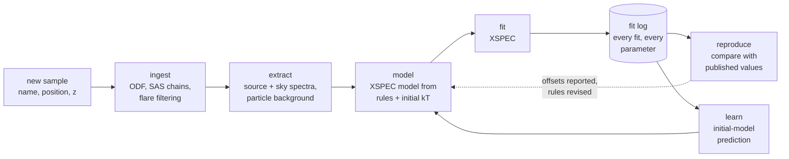
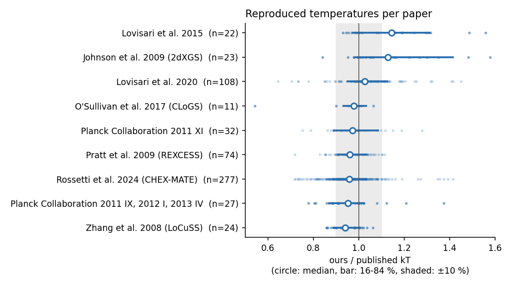
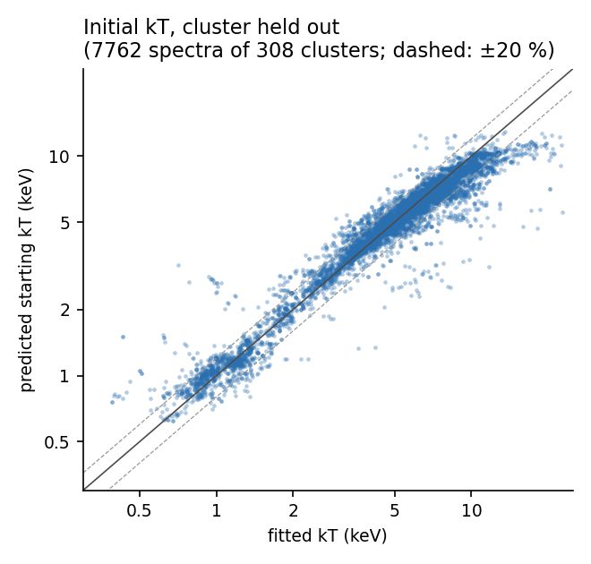

# XMM-Newton cluster spectroscopy: reproducing the literature, learning initial models

X-ray spectral fitting of galaxy clusters is still largely done by hand. For every cluster an expert
chooses the region, the background treatment, the energy band and the starting XSPEC model, and two
careful analyses of the same observation often differ by 10-15 %. This project writes that judgement
down as explicit rules, checks the rules by reproducing published temperatures with one code base and
no tuning toward the published numbers, and logs every fit as training data for a model that proposes
the starting point of the next fit.

*The pipeline runs end to end and is in trial use.* <!-- numbers:snapshot -->
Snapshot of the data: 2026-11-26.
<!-- /numbers -->



## Rules for the agent

Most of the code was written by an AI coding agent (see [Roles](#roles)). It worked under these rules:

- **Published values are targets only.** They are stored next to each fit for the comparison; no fit,
  rule or model input reads them, and no setting is changed to move a result toward them.
- **Quality rejection never sees the published value.** A cluster is left out only by data-quality rules
  (`xmmcluster/rules.py`: flares, untrusted fits, temperatures at the fit limit), applied whatever its ratio.
- **Every server command is logged**, and the expensive parameter-search commands (`error`,
  `steppar`, `chain`) are refused unless authorised.
- **Offsets are reported, not tuned away.** Where a paper's method cannot be followed, the departure is
  written down and the offset is kept in the statistics.

## Results so far

<!-- numbers:headline -->
- **12 papers reproduced**: 734 temperatures of 334 paper-cluster pairs (244 clusters). Median ratio ours / published **0.98**; **70%** within 10 % and **90%** within 20 %. 97 further values are left out by the data-quality rules (rejected data, or kT at the fit limit), whatever their ratio.
- **Initial-model prototype**: from band fluxes measured before any fit, extra trees predict the starting kT of a cluster they never saw (7,762 spectra of 308 clusters, leave-one-cluster-out) with a median error of **7.1%**; 84% are within 20 %. On the 4,525 spectra (166 clusters) that have a catalogue temperature, the prediction's median error is 5.7% against 14.3% for the catalogue kT; the median kT of the training clusters is off by 32.8%.
<!-- /numbers -->



<!-- numbers:papers -->
| paper | compared | clusters | values | median ratio | 16-84 % | within 10 % | within 20 % |
|---|---|---|---|---|---|---|---|
| Zhang et al. 2008 (LoCuSS) | kT in 0.2-0.5 r500 | 24 | 24 | 0.94 | 0.89-1.01 | 75% | 100% |
| Planck Collaboration 2011 XI | T_X in 0.15-0.75 R500 | 32 | 32 | 0.97 | 0.89-1.08 | 69% | 91% |
| Planck Collaboration 2011 IX, 2012 I, 2013 IV | T_X in 0.15-0.75 R500 | 27 | 27 | 0.95 | 0.87-1.02 | 59% | 89% |
| Lovisari et al. 2015 | group kT | 11 | 22 | 1.14 | 0.97-1.31 | 45% | 68% |
| Lovisari et al. 2020 | kT in 0-1 and 0.15-1 R500 | 54 | 108 | 1.03 | 0.95-1.12 | 66% | 88% |
| Rossetti et al. 2024 (CHEX-MATE) | kT profiles (annuli) | 26 | 277 | 0.96 | 0.89-1.03 | 73% | 93% |
| Johnson et al. 2009 (2dXGS) | group kT in 0.1-0.3 r500 | 23 | 23 | 1.13 | 0.99-1.41 | 43% | 65% |
| Pratt et al. 2009 (REXCESS) | kT in 0.15-1 R500 | 26 | 74 | 0.96 | 0.91-1.03 | 84% | 99% |
| O'Sullivan et al. 2017 (CLoGS) | group system kT | 11 | 11 | 0.98 | 0.93-1.03 | 73% | 82% |
| Eckert et al. 2025 (X-GAP) | group kT in 0-300 kpc | 23 | 23 | 1.03 | 0.98-1.06 | 91% | 100% |
| Schellenberger et al. 2015 (HIFLUGCS) | EPIC kT in 0.7-7 keV, r < 3.5 arcmin | 41 | 41 | 1.00 | 0.96-1.04 | 90% | 98% |
| Bulbul et al. 2019 (SPT-SZ) | MOS kT in < R500 and 0.15-1 R500 | 36 | 72 | 1.01 | 0.89-1.19 | 50% | 81% |
<!-- /numbers -->



Median error of the starting kT by fitted temperature (median |ln(kT_start / kT_fit)|, cluster held out):

<!-- numbers:bins -->
| fitted kT | spectra | clusters | prediction | catalogue kT |
|---|---|---|---|---|
| 0-1 keV | 437 | 38 | 11.3% | 19.3% |
| 1-2 keV | 720 | 63 | 7.8% | 21.8% |
| 2-4 keV | 1,151 | 95 | 7.1% | 19.0% |
| 4-8 keV | 4,171 | 189 | 5.4% | 11.7% |
| 8-12 keV | 1,102 | 75 | 12.3% | 15.4% |
| 12 keV and above | 181 | 19 | 34.1% | 28.3% |
<!-- /numbers -->

The prediction needs no catalogue, so it also works for clusters that are in none. Its weak end is the
hottest clusters, which are few in the training set. The catalogue baseline is the MCXC mass (from
ROSAT luminosities) turned into kT with the M-T relation of Arnaud et al. 2005, so it is a rough
starting point rather than a spectroscopic temperature.

## Quick start

```bash
pip install -e .
python -m demo.reproductions   # per-paper table and docs/figures/reproductions.png
python -m demo.initmodel       # leave-one-cluster-out training and docs/figures/initmodel.png
```

The initial-model demo takes a minute or two on a laptop; `--folds 10` (ten folds of whole clusters) is faster.
The seeds are fixed, but tree ensembles are not bit-identical across operating systems and library
versions, so the last digit of the initial-model numbers can differ from the ones above (they were
generated on macOS; the Linux CI runner gives a slightly different overall median error).
`pytest` runs the tests. `python -m demo.readme_numbers` rewrites the numbers above from the bundled CSVs.

## What is in this repository

- `xmmcluster/compare.py`: the per-paper comparison and the left-out rules.
- `xmmcluster/rules.py`: the decision rules of the automatic fit (bands, screening, regions, quality flags, verdict).
- `xmmcluster/fitlog_schema.py`: the fit-log record and its validation.
- `xmmcluster/initmodel/`: features, extra trees with leave-one-cluster-out evaluation, the replay
  summary, and the band-flux measurement (reference; it needs the spectra).
- `data/summary/reproduction_points.csv`: one row per compared value (ours, published, ratio, data-quality verdict).
- `data/initmodel/spectra.csv`: one row per fitted spectrum (band fluxes, z, N_H, region, fitted kT and Z,
  catalogue kT). Column definitions are in `xmmcluster/initmodel/data.py`.
- `pipeline/`: interfaces of the server-side stages (ingest, automatic fit, sky spectrum, new-sample
  runner), the first run on a new sample, and `config.example.yaml`, with placeholders only.

## What is not in this repository, and why

- **Server-side code** (ingest, extraction, automatic fit, XSPEC execution, job control). It is written for one analysis
  server and its file layout. `pipeline/interfaces.py` describes what each stage does.
- **Raw and intermediate data** (observation data files, event files and spectra, far too large for a
  repository) and the full fit log, which holds server paths. The bundled tables are derived from them.
- **Data outside the scope of this snapshot.** It includes only clusters whose observations were
  downloaded from the XMM-Newton Science Archive and processed end to end by this pipeline. Results on
  data processed separately before this pipeline existed are left out, together with the papers that
  were reproduced only on those data.
- **Unpublished results**, including work in preparation on individual clusters.

## Roles

I (Daocheng Wu) set the design and the direction: what to reproduce and in which order, the rules for
the agent above, and the acceptance checks a reproduction has to pass before it counts. The code was
written largely with Claude Code (an AI coding agent) under my direction. I reviewed the results,
decided how to treat offsets and failures, and chose what is published here.

The project is work in progress. The pipeline now runs end to end: from a list of names, positions and
redshifts it downloads the observations, processes them, fits them and gives each cluster a verdict.
Its first run, on three clusters outside every reproduced sample, took 3 h 20 min with no manual step;
two were accepted and the nearby one was rejected as designed (`pipeline/README.md`). The fit log behind
this snapshot is frozen as the training set of the initial model, and the next test is a larger new
sample that the model has not seen. The coolest groups and the hottest clusters are still the thin
ends of the training set, and the server-side code is not yet in a shareable form.

## License

MIT (see `LICENSE`).
